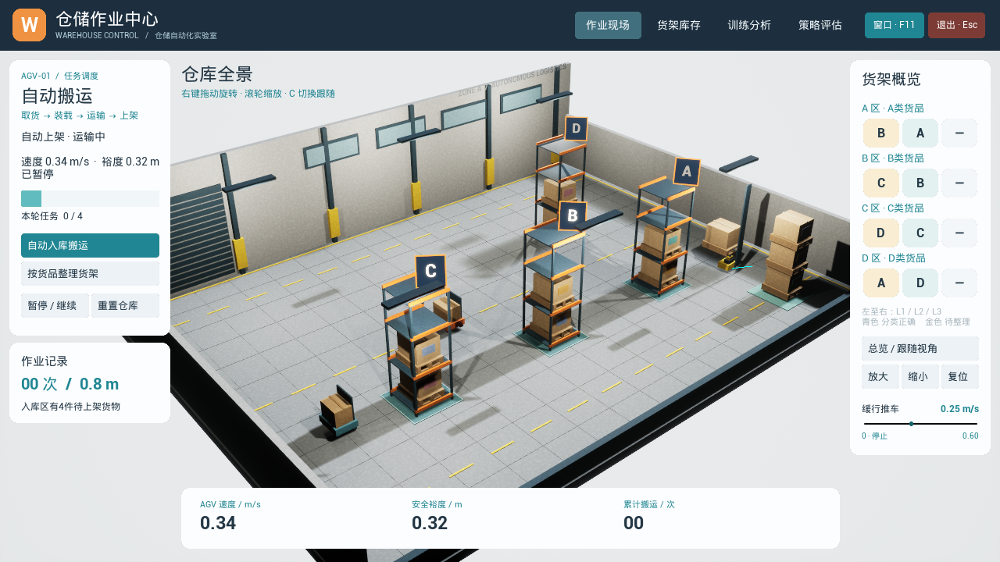
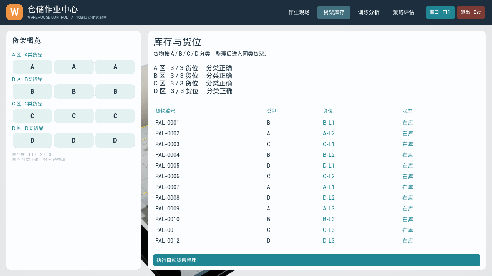
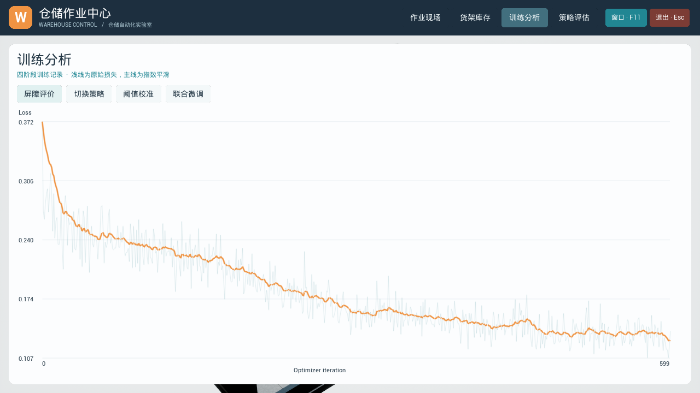
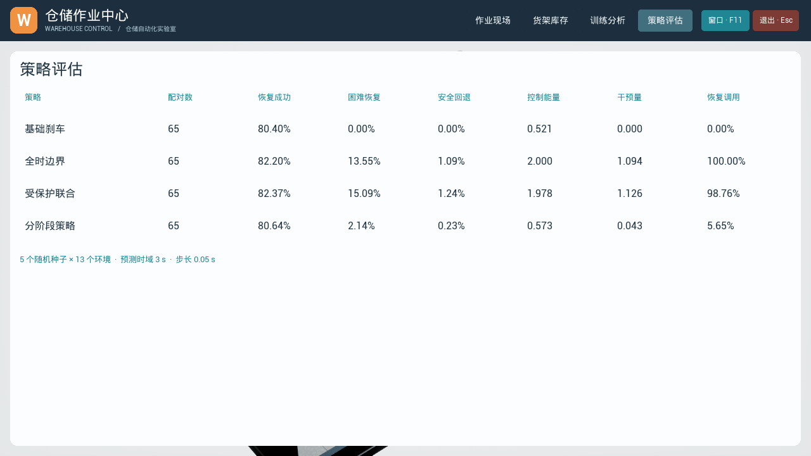

# UE 5.8 仓库避障：屏障引导切换策略 + libtorch

已加入自动搬运与货架整理。启动后点击“自动入库搬运”或“按货品整理货架”，操作与验证说明见 [OPERATIONS_GUIDE.md](OPERATIONS_GUIDE.md)。界面采用浅色仓储工作台，分为作业现场、货架库存、训练分析和策略评估。

四个界面通过顶部按钮切换：**作业现场**显示三维场景和自动搬运；**货架库存**显示货位及逐件货物明细；**训练分析**查看 A/B/C/D 四阶段损失及 EMA；**策略评估**比较恢复成功率、安全回退、能量和干预量。

默认仓库包含两辆缓行推车。界面使用0～0.60 m/s速度滑条，可在作业中实时调整，保留当前位置和往返方向；拉到0停止，再加速沿原方向继续。推车会在路径端点反向；导航预测会同时推进机器人和推车的位置。

首次运行时请将 `D:\Libraries\libtorch` 替换为自己的 libtorch 安装路径。UE 安装路径默认是 `C:\Program Files\Epic Games\UE_5.8`；其他位置可通过 `-Engine` 参数指定，例如 `./scripts/build-unreal.ps1 -Engine "D:\Epic Games\UE_5.8"`。`LIBTORCH_ROOT` 环境变量也可用于指定 libtorch。

本工程根据朱华天《域自适应屏障引导切换策略：面向安全恢复的结构化协同学习》（2026-10-07）实现算法与仓库迁移实验。训练是 **C++ libtorch**，并非 Python PyTorch。UE 用原生 C++ 执行导出的 MLP 权重，避免将训练依赖加载进游戏进程。

## 界面截图



| 货架库存 | 训练分析 | 策略评估 |
|---|---|---|
|  |  |  |

[查看自动装载近景](docs/screenshots/handling-closeup.png)

## 使用

在本目录打开 PowerShell：

```powershell
./scripts/build-trainer.ps1 -TorchRoot "D:\Libraries\libtorch"
./scripts/train.ps1 -Steps 600 -Seeds 5
./scripts/build-unreal.ps1
./scripts/run-unreal.ps1
```

训练端需要 C++20 编译器、CMake 3.20 及 libtorch 2.13 CPU；UE 工程按 Unreal Engine 5.8 构建。训练程序和 UE 推理分别编译运行：前者使用 libtorch，后者直接读取导出的 JSON 模型。训练无需 Python，UE 运行时无需加载 torch。

双圆基准：`./scripts/train.ps1 -Paper -Steps 600 -Seeds 5`。流水线检查：`./scripts/train.ps1 -Smoke -Seeds 1`，只训练几步，输出标记 smoke，不能作为实验结果。默认训练包含低速移动推车，静态训练使用 `-Static`。仓库训练脚本会将 seed0 权重、训练曲线、评估汇总复制到 `Content/Models/model.json`；训练其他种子不会覆盖 seed0。

## 三维场景与操作

场景在 GameMode BeginPlay 程序化生成，无需商城素材：四组三层货架与两辆低速移动推车（静态模式为六组货架）、木托盘、堆叠纸箱、AGV 门架与货叉、车轮、扫描器、装卸卷帘门、高窗、工业灯、混凝土地面及交通标线。使用 PBR 材质、投影和透视相机。每组货架可见外形包在半径 0.75 m 的圆形障碍内，自动作业的机器人空载包络半径 0.38 m，载货时为 0.85 m；论文恢复实验保持 0.30 m。

| 键 | 操作 |
|---|---|
| 1 | 基础刹车策略 |
| 2 | 屏障阈值硬门控 + 学习切换策略 |
| 3 | 全时边界切换策略 |
| N | 切换论文恢复实验 / 仓库目标导航扩展 |
| C | 斜俯视总览 / AGV 跟随视角 |
| R | 重置同一初始条件 |
| Space | 暂停 / 继续 |
| F11 / Esc | 全屏切换 / 保存并退出 |

现场页支持按住鼠标右键或中键旋转场景，使用滚轮缩放；右侧提供视角、全屏与退出按钮。推车速度使用实时滑条调节，不重置当前位置。

青色轨迹为备份或名义动作，红色轨迹为学习恢复分支。屏幕报告 h、tau、安全裕度和累计能量；结束记录到 `Saved/Logs/WarehouseBarrier.log`。状态用米和秒，UE 显示坐标乘以 100。为了保持与训练一致，动力学由固定 0.05 s 步长的解析双积分器更新，未使用 Chaos 车辆动力学。

导航模式属于应用扩展：名义 PD 动作先经过“执行一步动作，然后刹车”的三秒离散预测；裕度不足则执行论文组合策略。自动搬运与整理采用任务队列、货位预约和实体装卸，导航动作单独统计作业指标。

材质资产已经包含在工程中。重建材质可用：

```powershell
& 'C:\Program Files\Epic Games\UE_5.8\Engine\Binaries\Win64\UnrealEditor-Cmd.exe' "$PWD\WarehouseBarrier.uproject" -run=pythonscript "-script=$PWD\scripts\create-material.py" -unattended -nullrhi
```

## 算法对应

| 论文对象 | 代码 |
|---|---|
| x=(px,py,vx,vy)，双积分器 | `System::step`，UE `Step` |
| h_theta(x,e) | 64×64 tanh MLP，备份 rollout 的 softmin 标签，smooth-L1 回归 |
| s_phi(x,e) | 64×64 tanh MLP，刹车符号预训练，再优化 rollout 安全裕度 |
| 支撑映射 | 每坐标严格 ±1；训练用 tanh(logit/0.25) 的 straight-through 梯度 |
| 离散梯度先验 | q=0.5*dt²*grad_p(h)+dt*grad_v(h)，高梯度区域 logistic 符号一致性 |
| tau_psi(e) | 32×32 tanh MLP，真实 brake-safe 样本的 h 之 0.1 分位数监督 |
| 受保护联合微调 | 冻结 h，仅训练 s 和 tau；soft gate 温度 0.1，保护权重 0.01 |
| 部署 | h<tau 才调用边界控制；否则刹车 |

联合损失使用原文的裕度项和保护项。恢复率、能量、门控调用和安全回退均由真实 rollout 统计。

## 参数补充与复现范围

动态扩展使用 30 维环境：前18维为六个障碍物 `(cx,cy,r)`，后12维为对应的 `(vx,vy)`；四组货架速度为零，两辆推车半径0.45 m，训练速度在0.15—0.40 m/s采样。两条移动路径分别为水平通道 y=0 和右侧通道 x=6；圆心在 x=±7、y=±5 处镜像反向。h/s 输入34维，tau输入30维，网络隐藏层保持论文的64/32宽度。状态、环境和门控均在每个 rollout 步更新。

默认导航沿下侧与右侧通道执行两段运输路线。恢复实验通过 N 键或界面按钮切换，也可用 `-PaperRecovery` 启动。自动运行验证：`./scripts/verify-unreal.ps1`，分别运行停止、0.15、0.30、0.45 m/s场景，记录末端位置、安全裕度与 libtorch/UE 推理一致性。

动态训练结果位于 `artifacts/warehouse_dynamic/`，静态五种子位于 `artifacts/warehouse_final/`，双圆试运行位于 `artifacts/paper_pilot/`。默认部署 seed0，界面表格按当前实验目录中的已完成随机种子汇总；曲线来自 seed0。

原论文包包含 tex、图和汇总 CSV，没有训练源码、原始状态样本、完整超参数或具体 13 域定义。算法、双圆基准与仓库实验采用以下公开补充参数；训练结果记录在各自的评估 CSV 中：

- dt=0.05 s，预测60步（3 s）；u_max=1 m/s²，刹车 clamp(-2v,-1,1)。
- 轨迹 softmin 为 -0.05*logsumexp(-c/0.05)，包括初始状态。
- 每阶段默认600次更新，batch=256；Adam 学习率 A/B/C=1e-3，D=3e-4。刹车方向预训练次数=max(4,steps/4)。
- 弱一致性权重0.02，输入扰动平滑权重0.001；q 范数>0.01 才施加一致性。
- 双圆：第一个圆心(0,0)，第二圆心 x∈[2.2,4.0]、y∈[-0.6,0.6]；半径[0.5,0.85]。状态位置[-4,4]²，速度[-2,2]²；基准视机器人为点。
- 仓库：边界[-8,8]×[-6,6] m；六圆中心为 x∈{-4,0,4}、y∈{-2,2}，每坐标均匀扰动±0.3；半径[0.6,0.9]。状态位置[-7.5,7.5]×[-5.5,5.5]，速度[-2,2]²；裕度扣除机器人半径0.3。
- C 阶段128个环境、每环境1024状态，仅在真实刹车安全样本上求分位数。
- 评估固定独立随机种子90000+seed，每域1024初始候选；只统计初始几何安全状态。所有方法使用相同初态；staged/joint 重置同一评估 RNG，支持配对比较。
- 本工程的13个测试环境由独立采样几何及额外间距/半径偏移组成，未采用作者未公开的原始13域。

安全指标在每个 0.05 s 离散时刻计算，评估时域为 3 s；学习屏障表示给定备份策略的有限时域裕度。UE 的圆形包络属于货架矩形外形的保守近似。

## 输出

`artifacts/<paper或warehouse>/seed*/`：loss.csv、metrics_staged.csv、metrics_joint.csv、barrier.pt、switch.pt、threshold.pt、model.json。`.pt` 是 C++ Module archive；JSON 为行优先权重及偏置，依次两层 tanh + 线性输出。

评估 CSV 包含 success、hard_recovery（刹车失败子集）、brake_safe_lost（刹车安全子集）、平均||u||²、平均||u-u_brake||、gate_usage。概率采用0至1，非百分数。

汇总：`python ./scripts/summarize.py ./artifacts/warehouse_dynamic`（动态）或 `./artifacts/warehouse_final`（已完成的静态五种子）。同一目录不要混合不同 steps 的重复 seed 实验作为5种子统计；smoke 自动排除。

集成依据：[PyTorch C++ frontend](https://docs.pytorch.org/tutorials/advanced/cpp_frontend.html)、[Unreal 第三方库说明](https://dev.epicgames.com/documentation/unreal-engine/integrating-third-party-libraries-into-unreal-engine?lang=zh-CN)。这里采用离线权重导出，UE 与 libtorch 无 DLL 链接关系。


